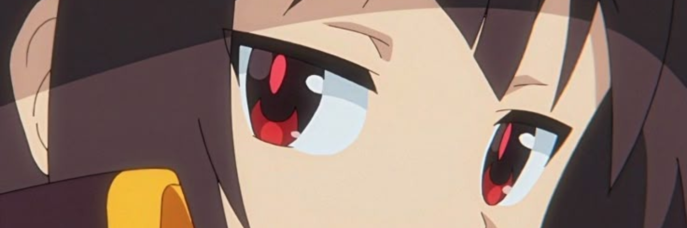

<!-- ======================================== -->
<!--              MEGUMIN BANNER              -->
<!-- ======================================== -->

  

<h1 align="center">Novro</h1>

  <i>One day, my code shall create an explosion worthy of the heavens.</i>

  

 

<!-- ======================================== -->
<!--                  ABOUT                   -->
<!-- ======================================== -->

## 💫 About Me

Currently an Undergraduate College Student.

Currently learning about anything :)

Exploring software development, experimenting with ideas,
and occasionally trying to make something explode.

 

<!-- ======================================== -->
<!--                 SOCIALS                  -->
<!-- ======================================== -->

## 🌐 Socials

  
  

 

<!-- ======================================== -->
<!--                TECH STACK                -->
<!-- ======================================== -->

## 🔮 Tech Stack

  
  
  
  
  
  
  
  
  

 

<!-- ======================================== -->
<!--                GITHUB STATS              -->
<!-- ======================================== -->

## 📊 GitHub Stats

  

  

  

 

<!-- ======================================== -->
<!--                  FOOTER                  -->
<!-- ======================================== -->

  <i>"EXPLOSION!!"</i>

  

  

  Made with magic, code, and an unreasonable amount of explosions.

